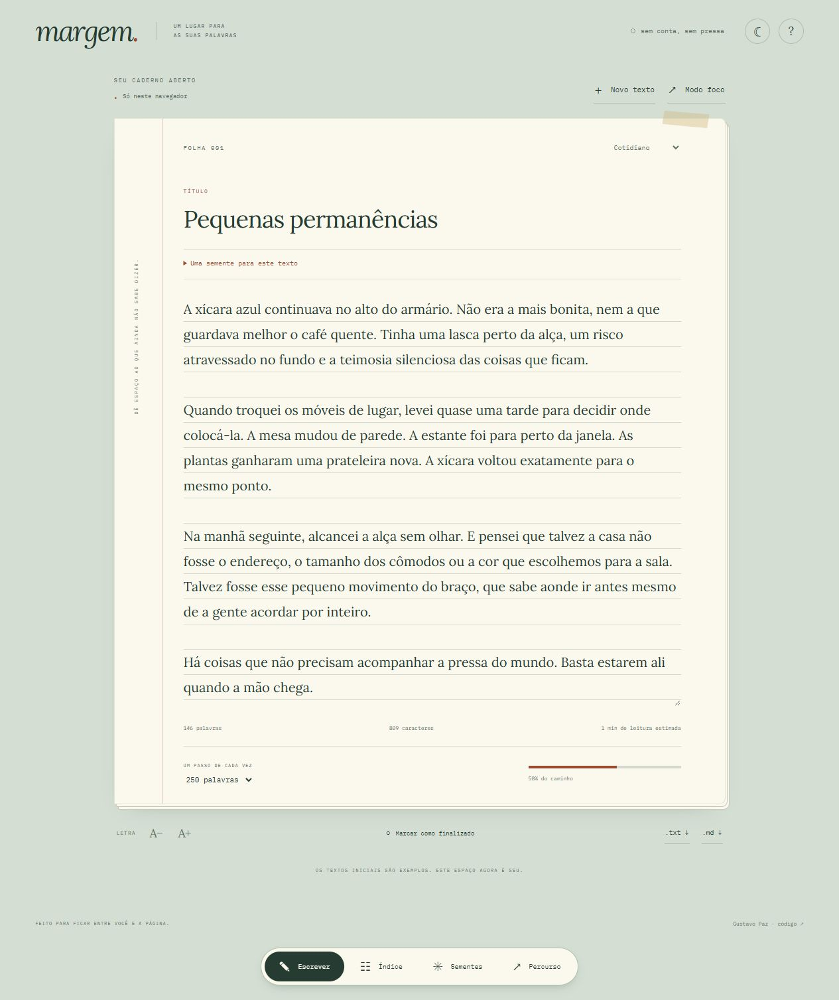

# Margem

Um caderno digital para escrever sem pressa, organizar começos e guardar as palavras por perto.

**[Abrir demonstração](https://gustapaz.github.io/margem/)** · [Código](https://github.com/gustapaz/margem)



## A experiência

- Editor com título e texto livre, contagem de palavras e caracteres, leitura estimada, tamanho de letra e tema noturno.
- Três cadernos, busca que ignora acentos e filtros de rascunho/finalizado.
- Cinco textos iniciais autorais, oito propostas de escrita e criação de novas páginas sem substituir textos existentes.
- Meta por texto, modo foco com saída por Escape e estatísticas calculadas do conteúdo atual.
- Salvamento automático local, remoção com confirmação e ação de desfazer.
- Exportação em TXT ou Markdown e backup JSON com importação validada e confirmada.

## Stack

**Elm 0.19.1 + Vite 8**, HTML e CSS. A arquitetura Model–Update–View mantém a lógica de escrita, filtros, contagem e serialização em Elm. Ports conectam somente recursos do navegador: armazenamento, arquivos e foco. O JavaScript compilado recebe um adaptador mínimo para ESM e é empacotado com nome de arquivo por hash.

Node.js 24 é suficiente; o compilador Elm é uma dependência local do projeto.

```sh
npm ci
npm run dev
npm test
npm run format
npm run build
npm run preview
```

Desenvolvimento e preview: http://127.0.0.1:5186/margem/. Depois de alterar arquivos Elm com o Vite já aberto, execute `npm run elm` para recompilar; o JavaScript gerado provoca o recarregamento. O build estático fica em `dist/`.

## Direção visual

Papel pautado, uma linha de margem terracota e uma mesa verde. A primeira tela é o próprio caderno, com texto Lora e controles IBM Plex Mono. A navegação fica numa pequena régua na base. Índice usa abas de caderno; propostas aparecem como fichas e o percurso usa composição tipográfica. O modo foco recolhe a navegação sem capturar rolagem. A estrutura e o CSS foram escritos para este projeto, sem reaproveitar shells do portfólio. Veja [docs/design.md](docs/design.md).

## Mocks, armazenamento e privacidade

Os cinco textos e oito propostas são fixtures originais. Não há conta, API, backend, banco, nuvem, telemetria ou serviço de IA. Nenhum conteúdo escrito é enviado por uma integração de aplicação. Tudo funciona no front-end, com fontes locais e hospedagem gratuita no GitHub Pages.

O localStorage guarda textos, seleção, metas e preferências, com atraso de 350 ms e salvamento ao sair da página. Se o navegador bloquear ou esgotar o armazenamento, uma mensagem informa a falha; exporte um backup. Limpar os dados do navegador remove o caderno. Não há sincronização automática; JSON permite transportar os dados manualmente. Múltiplas abas usam o último salvamento, sem edição colaborativa.

Até 100 textos, título de 120 caracteres e corpo de 80 mil caracteres por texto. Importação aceita arquivos JSON de até 50 MB, valida versão, limites e identidades e só substitui o conteúdo após confirmação. O desfazer recupera o último texto removido durante a sessão, enquanto o aviso estiver disponível.

## Validação

12 testes Elm cobrem contagem, leitura, metas, atualização, criação, limite de entradas, exclusão, filtros e backups. Compilação otimizada e build de produção aprovados. Revisão de navegador verifica criação, salvamento e reload, seleção de caderno, foco/Escape, tema, remoção/desfazer, busca vazia, propostas, backup inválido e válido e download Markdown. Telas de 320, 390, 768 px e desktop inspecionadas. Registro em [docs/validacao.md](docs/validacao.md).

A página tem idioma, título, descrição, canonical, imagem social e introdução HTML, mas é uma aplicação renderizada no cliente. Textos privados do usuário não são páginas públicas indexáveis. Não foram atribuídas notas Lighthouse ou certificação integral de acessibilidade.

## Licenças

Código MIT. Lora e IBM Plex Mono sob SIL Open Font License, com textos em `docs/LICENSE-*.txt`. As fontes são distribuídas localmente e preservam suas atribuições. Demais dependências conservam suas licenças.
